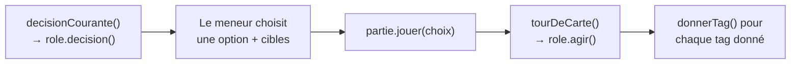
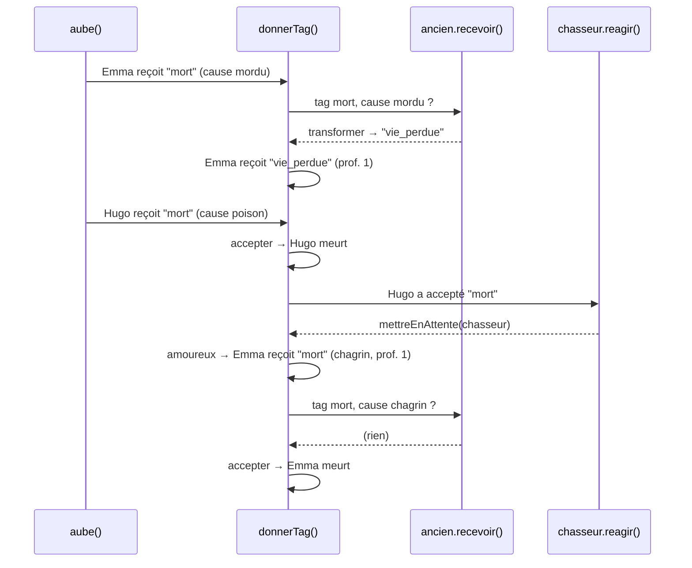

# Cas particulier : l'Ancien amoureux du Chasseur

Lié à : [[donner-recevoir]] · [[loup-garou-projet]]

> [!abstract] Le cas en une phrase
> Nuit 2 : les loups mordent **Emma (Ancien)**, la sorcière empoisonne **Hugo (Chasseur)**, et Cupidon les a liés la première nuit. Emma survit à la morsure… puis meurt quand même de chagrin, et Hugo, en mourant, abat le loup.

Ce cas fait passer une partie par **tous les mécanismes du moteur** en une seule nuit : ordre par priorité, champ `tours`, blocage, transformation, chaîne de tags, réaction différée, ordre de l'aube et victoire. Il est rejoué automatiquement par `npm test`, et `npm run scenario` affiche son journal.

---

## La table

| Joueur | Rôle | Fichier |
| --- | --- | --- |
| Alice | Salvateur | `roles/salvateur.ts` |
| Bob | Loup-Garou | `roles/loup.ts` |
| Chloé | Sorcière | `roles/sorciere.ts` |
| David | Villageois | `roles/villageois.ts` |
| Emma | Ancien | `roles/ancien.ts` |
| Hugo | Chasseur | `roles/chasseur.ts` |
| Inès | Cupidon | `roles/cupidon.ts` |
| Jules | Voyante | `roles/voyante.ts` |

## Ce qui s'est passé la nuit 1

- **Cupidon** lie Emma et Hugo : chacun reçoit le tag `amoureux`, avec en métadonnée `partenaires` la liste qui contient l'id de l'autre.
- **Salvateur** protège David → David reçoit `protege` (expire à l'aube).
- **Loups** attaquent David → la règle du tag `mordu` voit `protege` et **bloque**.
- **Aube** : `protege` posé par le salvateur devient `protege_hier`. Personne ne meurt, le village n'élimine personne.

État au début de la nuit 2 : Emma et Hugo portent `amoureux`, David porte `protege_hier`.

---

## Nuit 2, pas à pas

### 0. Qui sera appelé ? — `Partie.commencerNuit()`

```ts
this.file = presents
  .filter(r => r.appelNuit && r.decision && peutAgir(r, this.tour))
  .sort((a, b) => (a.priorite ?? 999) - (b.priorite ?? 999))
```

| Rôle | `appelNuit` | `tours` | Priorité | Appelé ? |
| --- | --- | --- | --- | --- |
| Cupidon | oui | `{ de: 1, chaque: 2, a: 3 }` | 50 | ❌ `peutAgir(cupidon, 2)` → `false` |
| Réunion des amoureux (étape) | oui | — | 60 | ✅ toujours dans la file ; Emma et Hugo sont amoureux, elle se joue (« Passer » après 60 s) |
| Voyante | oui | — | 80 | ✅ |
| Salvateur | oui | — | 100 | ✅ |
| Loup | oui | — | 120 | ✅ |
| Sorcière | oui | — | 130 | ✅ |
| Ancien, Chasseur, Villageois | non | | | ❌ jamais appelés la nuit |

File de la nuit : `["reunion-amoureux", "voyante", "salvateur", "loup", "sorciere"]`.

Pour chaque carte, l'interface suit le même cycle :



### 1. Voyante — elle regarde, elle ne donne rien

Le meneur choisit « Sonder » → Chloé. `voyante.agir()` renvoie uniquement une info :

```ts
return { infos: [{ pour: moi.id, texte: `${cible.nom} est ${partie.titre(cible.role)}.` }] };
```

`tourDeCarte()` range l'info dans `partie.infos` (privée, pour Jules). Aucun tag n'est posé.

### 2. Salvateur — il donne, mais le receveur refuse

L'écran de décision affiche déjà « impossible : David », grâce à `salvateur.decision()` qui lit `joueursAvecTag("protege_hier")`. Supposons que le meneur insiste et choisisse David :

1. `salvateur.agir()` → `{ donner: [{ tag: "protege", a: "david" }] }`
2. `donnerTag(David, "protege")` : David est Villageois, son rôle n'a pas de `recevoir()`, on passe au `switch` :

```ts
case "protege":
  if (partie.aTag(joueur, "protege_hier")) return r.bloquer("déjà protégé la nuit dernière");
```

Le salvateur ne connaît pas cette contrainte : c'est le **receveur** qui la fait respecter.

### 3. Loups — morsure acceptée

`loup.agir()` → `{ donner: [{ tag: "mordu", a: "emma" }] }`.

`donnerTag(Emma, "mordu")` :
- `ancien.recevoir()` est appelé, mais il ne s'intéresse qu'au tag `mort`. Il ne renvoie rien → on continue.
- `switch` → `case "mordu"` : Emma n'est pas protégée → **accepter**. Emma porte désormais `mordu`.

> [!note] Pourquoi l'Ancien ne réagit-il pas dès la morsure ?
> Parce qu'une morsure peut encore être annulée par la sorcière. L'Ancien n'agit qu'au moment où la morsure devient une **mort**, c'est-à-dire à l'aube.

### 4. Sorcière — elle regarde ET donne

`sorciere.decision()` lit `joueursAvecTag("mordu")` → « Victime(s) de la nuit : Emma ». Elle a ses deux potions, donc trois choix : Potion de vie, Potion de mort, Ne rien faire.

Le meneur choisit « Potion de mort » → Hugo :

```ts
case "tuer":
  moi.memoire.potionMort = false;
  return { donner: [{ tag: "empoisonne", a: choix.cibles[0] }] };
```

`donnerTag(Hugo, "empoisonne")` : `chasseur` n'a pas de `recevoir()`, `switch` → `default` → **accepter**.

La file est vide : l'interface propose « Le village se réveille ».

---

## L'aube : la cascade

`partie.leverLeJour()` appelle `aube()`, qui traite les tags **dans l'ordre du tableau** :

```ts
const CONSEQUENCES = [
  { tag: "mordu",      devient: "mort", meta: { cause: "mordu" } },
  { tag: "empoisonne", devient: "mort", meta: { cause: "poison" } },
  { tag: "protege",    devient: "protege_hier", si: t => t.source === "salvateur" }
];
```

### Vague 1 — `mordu` : Emma

`aube` retire `mordu` d'Emma puis appelle `donnerTag(Emma, "mort", { cause: "mordu", source: "loup" })` :

1. `ancien.recevoir()` : tag `mort`, cause `mordu`, pas encore `vie_perdue` → **transformer** en `vie_perdue`.
2. `transformer` rappelle `donnerTag(Emma, "vie_perdue")` avec **profondeur 1** → `default` → accepté.
3. Le `switch` n'est jamais atteint pour `mort` : Emma reste vivante.

### Vague 2 — `empoisonne` : Hugo, puis tout s'enchaîne

`donnerTag(Hugo, "mort", { cause: "poison", source: "sorciere" })` :

1. `chasseur.recevoir` n'existe pas → `switch` → `case "mort"`.
2. `r.accepter()` :
   - Hugo reçoit `mort`, `vivant = false`, entrée `recu` au journal ;
   - puis `chasseur.reagir("mort")` → `partie.mettreEnAttente("chasseur", Hugo)`. **Le chasseur ne tire pas encore** : sa décision est mise de côté.
3. Retour dans `case "mort"` : Hugo a une partenaire vivante (Emma, dans `partenairesDe(Hugo)`) → `donnerTag(Emma, "mort", { cause: "chagrin" }, profondeur 1)` :
   - `ancien.recevoir()` : la cause est `chagrin`, pas `mordu` → ne renvoie rien ;
   - `switch` → `case "mort"` → **accepter** : Emma meurt ;
   - son partenaire, Hugo, est déjà mort → la chaîne s'arrête.

### Vague 3 — `protege`

Personne ne porte `protege` (la protection de David a été refusée). Rien à faire.



### La décision urgente du Chasseur

Après `aube()`, `partie.attente` contient `{ alias: "chasseur", joueur: "hugo" }`. `decisionCourante()` donne **toujours la priorité** à cette file d'attente, quelle que soit la phase : l'interface affiche la carte du Chasseur, bordée de rouge, sans bouton « Passer ».

Le meneur choisit « Tirer » → Bob. Le Chasseur passe par le **même** chemin que n'importe quelle carte :

```ts
agir: (choix) => ({ donner: [{ tag: "mort", a: choix.cibles[0], meta: { cause: "chasseur" } }] })
```

`donnerTag(Bob, "mort")` → `loup` n'a pas de `recevoir()` → accepté. Bob meurt.

### Rapport et victoire

- Le rapport (`partie.morts()`) lit les entrées `recu mort` du journal depuis le début de l'aube : **Hugo** (empoisonné), **Emma** (morte de chagrin), **Bob** (abattu par le chasseur).
- Le bouton « Événement du jour » appelle `ouvrirEvenement()`, qui vérifie d'abord la victoire. Il ne reste aucun loup → **le village gagne**.

---

## Le journal réel

Sortie de `npm run scenario` (nuit 2). L'indentation correspond à la `profondeur` :

```
[nuit     ] action Voyante : sonder → Chloé  (source=voyante)
[nuit     ] info Chloé est Sorcière.
[nuit     ] action Salvateur : proteger → David  (source=salvateur)
[nuit     ] bloque protege → David  (source=salvateur raison="déjà protégé la nuit dernière")
[nuit     ] action Loup-Garou : devorer → Emma  (source=loup)
[nuit     ] recu mordu → Emma  (source=loup)
[nuit     ] action Sorcière : tuer → Hugo  (source=sorciere)
[nuit     ] recu empoisonne → Hugo  (source=sorciere)
[aube     ] phase aube
[aube     ] transforme mort → Emma  (source=loup cause=mordu en=vie_perdue)
[aube     ]   recu vie_perdue → Emma  (source=loup cause=mordu)
[aube     ] recu mort → Hugo  (source=sorciere cause=poison)
[aube     ]   recu mort → Emma  (source=hugo cause=chagrin)
[aube     ] action Chasseur : tirer → Bob  (source=chasseur)
[aube     ] recu mort → Bob  (source=chasseur cause=chasseur)
[fin      ] phase fin

Vainqueur : Le village
```

---

## Où vit chaque règle de ce cas

| Règle | Où | Côté |
| --- | --- | --- |
| Cupidon n'agit que la nuit 1 | `roles/cupidon.ts` → `tours` | appel |
| La voyante apprend un rôle | `roles/voyante.ts` → `agir()` | donner (info) |
| Pas deux protections de suite | `recevoir.ts` → `case "protege"` | recevoir (règle générale) |
| Une morsure est bloquée par une protection | `recevoir.ts` → `case "mordu"` | recevoir (règle générale) |
| L'Ancien survit à la première morsure | `roles/ancien.ts` → `recevoir()` | recevoir (rôle) |
| Les amoureux meurent ensemble | `recevoir.ts` → `case "mort"` | recevoir (règle générale) |
| Le Chasseur tire en mourant | `roles/chasseur.ts` → `reagir()` + `decision()` + `agir()` | réaction |
| Les morsures avant les poisons | `aube.ts` → ordre de `CONSEQUENCES` | aube |

Aucun rôle ne connaît les autres : le loup ignore l'Ancien et le Salvateur, la sorcière ignore le Chasseur.

---

## Et si… ?

> [!question] …la sorcière avait sauvé Emma au lieu d'empoisonner Hugo ?
> `donnerTag(Emma, "sauve")` → `case "sauve"` retire `mordu` et **consomme** le tag. À l'aube, il n'y a plus de `mordu` sur Emma : l'Ancien garde sa vie supplémentaire pour une prochaine fois.

> [!question] …on inversait l'ordre de l'aube (poison avant morsure) ?
> Testé : Hugo meurt d'abord, Emma meurt de chagrin à profondeur 1, puis la vague `mordu` trouve Emma déjà morte et l'ignore. **Mêmes morts, journal différent** : l'entrée `transforme → vie_perdue` disparaît. Ici le résultat ne change pas, mais avec d'autres rôles (un tag qui réagit à `vie_perdue`, par exemple), il changerait. L'ordre de `CONSEQUENCES` est donc une vraie règle du jeu, à garder visible.

> [!question] …le Chasseur avait eu un `recevoir()` au lieu d'un `reagir()` ?
> S'il avait écrit `recevoir(tag) { r.accepter(); …; return "accepte"; }`, il aurait **court-circuité** le `switch` : la règle des amoureux ne se serait jamais exécutée et Emma aurait survécu. C'est pourquoi le prototype sépare :
> - `recevoir()` : **avant**, pour intercepter ou modifier le tag (l'Ancien) ;
> - `reagir()` : **après**, une fois le tag accepté, pour déclencher autre chose (le Chasseur).

> [!question] …les loups mordaient encore Emma la nuit 3 (si elle avait survécu) ?
> Elle porte `vie_perdue` : `ancien.recevoir()` ne transforme plus rien, la mort passe par le `switch` et elle meurt.

---

## Rejouer ce cas

```bash
npm test           # vérifie les morts, la transformation, le blocage et la victoire
npm run scenario   # affiche le journal ci-dessus
```

Le scénario est écrit dans `src/moteur/scenario.ts` : pour tester une variante, copie `nuitDeux()` et change un choix.
