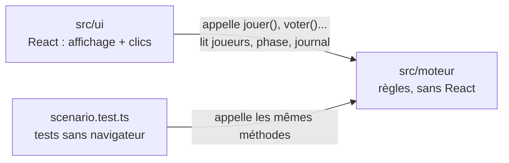
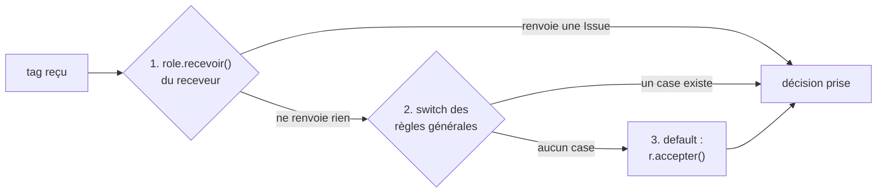

# Design patterns du prototype

Liens : [[fonctionnement-du-code]] · [[donner-recevoir]] · [[resolveur-approches]] · [[loup-garou-projet]]

> [!abstract] But de cette note
> Pour chaque problème d'architecture rencontré dans le projet :
> - **le problème** posé ;
> - **la solution retenue** et l'endroit où elle se trouve dans le code ;
> - **les alternatives** qu'on aurait pu choisir, comparées ;
> - **quand il faudrait changer d'avis**.
>
> Un « design pattern » (patron de conception) est une solution connue et nommée à un problème qui revient souvent. Connaître le nom aide à chercher de la documentation, mais l'important est de comprendre **quel problème** chaque solution résout.

## Sommaire

| # | Pattern | Problème résolu | Fichier(s) |
| --- | --- | --- | --- |
| 1 | Séparation moteur / interface | Tester et faire évoluer les règles sans toucher à l'affichage | `moteur/` vs `ui/` |
| 2 | Contrats typés (interfaces) | Savoir exactement ce qu'un rôle doit fournir | `types.ts` |
| 3 | Registre | Trouver un rôle à partir de son alias, sans `switch` géant | `roles/index.ts` |
| 4 | Stratégie avec crochets optionnels | Donner à chaque rôle son propre comportement | `roles/*.ts` |
| 5 | Effets décrits par des données | Garder un point d'entrée unique pour toutes les modifications | `agir()` → `donner.ts` |
| 6 | État par joueur, rôles sans état | Deux sorcières ne doivent pas partager leurs potions | `joueur.memoire`, `init()` |
| 7 | Chaîne de responsabilité courte | Décider qui a le dernier mot sur un tag | `recevoir.ts` |
| 8 | Objet de réponses | Forcer chaque décision à passer par le journal | `reponses()` dans `recevoir.ts` |
| 9 | Crochets avant / après | Séparer « empêcher » et « réagir » | `recevoir()` / `reagir()` |
| 10 | Récursion bornée | Éviter les boucles infinies de tags | `profondeur` dans `recevoir.ts` |
| 11 | Table de règles | Rendre l'aube lisible et ordonnée | `CONSEQUENCES` dans `aube.ts` |
| 12 | Machine à états | Empêcher les enchaînements de phases impossibles | `phase` dans `partie.ts` |
| 13 | Files d'attente « tirées » par l'interface | Enchaîner les cartes et les décisions urgentes | `file`, `attente`, `decisionCourante()` |
| 14 | Journal d'événements | Rapport, débogage, futur « annuler » | `journal`, `log()`, `morts()` |
| 15 | Injection de l'aléatoire | Rendre les tests reproductibles | option `aleatoire` |
| 16 | État remonté + composants contrôlés | Partager les réglages entre les pages | `App.tsx` |
| 17 | Moteur mutable + rendu forcé | Faire cohabiter une classe qui se modifie et React | `rafraichir()` dans `App.tsx` |
| 18 | État dérivé | Ne jamais stocker ce qui peut se recalculer | `Preparation.tsx`, `PartieVue.tsx` |
| 19 | Réinitialisation par clé | Vider la sélection quand la décision change | `useEffect([cle])` dans `PartieVue.tsx` |
| 20 | Composants de présentation | Ne dessiner la table qu'une seule fois | `Table.tsx`, `Visuel.tsx` |
| 21 | Point d'accès unique aux données | Passer du localStorage à SQLite en un seul fichier | `stockage.ts` |

---

# Partie 1 — Architecture générale

## 1. Séparation moteur / interface

### Le problème
Les règles du Loup-Garou (qui mord qui, qui meurt, qui gagne) et l'affichage (boutons, table ronde, couleurs) changent pour des raisons différentes. Si elles sont mélangées, chaque modification de l'un risque de casser l'autre, et il devient impossible de vérifier les règles sans ouvrir un navigateur et cliquer.

### La solution retenue
Deux dossiers qui ne se mélangent pas :
- `src/moteur/` : TypeScript pur. **Aucun `import` de React.** On y trouve la classe `Partie`, les rôles, `donnerTag()`…
- `src/ui/` : React. Les composants affichent l'état de `partie` et appellent ses méthodes. **Aucune règle de jeu.**

La dépendance va dans un seul sens : l'interface connaît le moteur, le moteur ne connaît pas l'interface.



La preuve que ça marche : `scenario.test.ts` joue des parties entières en appelant `p.jouer(...)`, `p.leverLeJour()`, etc., exactement comme le fait `PartieVue.tsx`, mais sans aucun écran.

### Les alternatives

| | Moteur séparé (retenu) | Logique dans les composants React | Logique côté serveur (Express) |
| --- | --- | --- | --- |
| Où vit « si protégé, pas mordu » | `recevoir.ts` | dans un `onClick` de `PartieVue` | dans une route `POST /jouer` |
| Tester une règle | `npm test`, en une seconde | il faut simuler des clics dans un navigateur | il faut lancer le serveur |
| Changer de framework (Svelte…) | on ne réécrit que `ui/` | on réécrit tout | on ne réécrit que le front |
| Fonctionne hors ligne | oui | oui | non, chaque clic attend le serveur |
| Complexité | moyenne | faible au début, forte ensuite | forte |

### Quand changer d'avis
Si un jour chaque joueur a l'application sur son téléphone, la partie devra vivre sur un serveur (sinon chaque téléphone aurait sa propre partie). Grâce à la séparation, le dossier `moteur/` pourra être **déplacé tel quel** côté Express : le serveur créera l'objet `Partie`, et les téléphones lui enverront des `ChoixFait`.

---

## 2. Contrats typés avec TypeScript

### Le problème
Le moteur appelle des méthodes de rôles qu'il ne connaît pas à l'avance. Comment être sûr qu'un nouveau rôle a bien la bonne forme (un `alias`, un `camp`, un `agir()` qui renvoie le bon format…) ?

### La solution retenue
`types.ts` décrit la forme de chaque objet. Exemple simplifié :

```ts
export interface Role {
  alias: string;
  titre: string;
  camp: Camp;                    // "village" | "loups" | "solo" : rien d'autre n'est accepté
  priorite?: number;             // le "?" veut dire "optionnel"
  decision?(partie: Partie, moi: Joueur): Decision;
  agir?(choix: ChoixFait, partie: Partie, moi: Joueur): ResultatAction | void;
  // ...
}
```

Quand on écrit `const corbeau: Role = { ... }`, TypeScript vérifie **avant même de lancer le code** :
- qu'aucun champ obligatoire ne manque ;
- que `camp` vaut bien une des trois valeurs autorisées (pas `"vilage"`) ;
- que `agir()` renvoie bien `{ donner, infos }` et pas autre chose.

Les **unions de chaînes** (`type Camp = "village" | "loups" | "solo"`) remplacent les « nombres magiques » ou les chaînes libres : l'éditeur propose les valeurs possibles et refuse les fautes de frappe.

### Les alternatives

| | TypeScript (retenu) | JavaScript + commentaires JSDoc | JavaScript sans rien |
| --- | --- | --- | --- |
| Faute de frappe sur un champ | erreur dans l'éditeur | avertissement si l'éditeur est configuré | bug silencieux pendant la partie |
| Autocomplétion | complète | partielle | faible |
| Étape de compilation | oui (`tsc`), gérée par Vite | non | non |
| Courbe d'apprentissage | un peu de syntaxe en plus | faible | aucune |

### Limite actuelle
`joueur.memoire` est typé `Record<string, any>` : n'importe quoi est accepté, donc TypeScript ne protège pas contre `moi.memoire.potionVi`. On pourrait typer la mémoire rôle par rôle, mais au prix de types génériques plus compliqués à lire. Pour un prototype, c'est un compromis volontaire.

---

# Partie 2 — Les rôles

## 3. Registre

### Le problème
Un joueur ne stocke que l'**alias** de son rôle (`"sorciere"`). Il faut pouvoir retrouver l'objet rôle complet à partir de ce texte, et pouvoir lister tous les rôles existants (pour la page Options et la distribution).

### La solution retenue
`roles/index.ts` est un **registre** : une liste unique et un dictionnaire construit à partir d'elle.

```ts
export const LISTE_ROLES: Role[] = [loup, villageois, voyante, sorciere, /* ... */];

// { loup: loup, villageois: villageois, ... } : une recherche par alias en une ligne
export const ROLES: Record<string, Role> = Object.fromEntries(LISTE_ROLES.map(r => [r.alias, r]));
```

Ensuite, `partie.role("sorciere")` renvoie `ROLES["sorciere"]`. Le reste du moteur ne connaît **aucun** rôle par son nom : il passe toujours par le registre. La page Options parcourt `LISTE_ROLES`, ce qui explique qu'un rôle enregistré apparaît tout seul.

Les événements suivent exactement le même modèle (`LISTE_EVENEMENTS` / `EVENEMENTS`).

### Les alternatives

| | Registre (retenu) | `switch` géant sur l'alias | Découverte automatique des fichiers |
| --- | --- | --- | --- |
| Exemple | `ROLES[alias].agir(...)` | `if (alias === "sorciere") {...} else if ...` | `import.meta.glob("./roles/*.ts")` (fonction de Vite) |
| Ajouter un rôle | 1 fichier + 1 ligne dans la liste | modifier le gros `switch` à plusieurs endroits | 1 fichier, rien d'autre |
| Voir la liste des rôles | lire `index.ts` | chercher dans tout le code | impossible sans lancer le code |
| Risque | oublier la ligne d'enregistrement | fonction de 800 lignes, conflits | fichier ajouté par erreur chargé quand même ; dépend de Vite (les tests via `tsx` ne le comprennent pas) |

Le `switch` géant est l'idée de départ (« IF carte === "Sorciere" ALORS… »). Le registre garde le même principe (l'alias décide du comportement) mais range chaque `case` dans son propre fichier.

---

## 4. Stratégie avec crochets optionnels

### Le problème
Chaque rôle fait quelque chose de différent, mais le moteur doit pouvoir les traiter tous de la même façon : « montre ta décision », « applique ton choix », « que fais-tu quand tu reçois ce tag ? ».

### La solution retenue
Chaque rôle est un **objet** qui respecte le contrat `Role`. Le moteur ne fait qu'appeler ses méthodes, **si elles existent** :

```ts
// donner.ts : le moteur ne sait pas quel rôle il appelle
role.agir?.(choix, partie, moi)

// recevoir.ts
const reaction = role.recevoir?.(tag, meta, r, partie, joueur);
```

Le `?.` (« chaînage optionnel ») veut dire : « si la méthode existe, appelle-la ; sinon, renvoie `undefined` ». Un Villageois n'a aucune méthode : il est simplement ignoré à chaque étape.

C'est le patron **Stratégie** : le moteur a un algorithme fixe (montrer → choisir → donner → recevoir) et délègue certains morceaux à un objet interchangeable. C'est aussi ce qu'on appelle l'**inversion de contrôle** : ce n'est pas le rôle qui décide quand il agit, c'est le moteur qui l'appelle au bon moment (« ne nous appelez pas, c'est nous qui vous appellerons »).

### Les alternatives

**A. Héritage de classes** (l'idée de départ : `Carte` → `CarteInfo`, `CarteAction`)

```ts
abstract class Carte { abstract agir(...): void; }
class CarteAction extends Carte { ... }
class CarteInfo extends Carte { ... }
class Sorciere extends ??? { ... }   // elle regarde ET elle agit
```

**B. Composition de capacités** (une carte possède une liste de capacités réutilisables)

```ts
const sorciere = { capacites: [voirLesMordus, potionDeVie, potionDeMort] };
```

**C. Mini-langage JSON** (les règles décrites en données, abandonné dans [[resolveur-approches]])

| | Objet + crochets (retenu) | Héritage de classes | Composition de capacités | Mini-langage JSON |
| --- | --- | --- | --- | --- |
| Sorcière (info + action) | une méthode `agir()` fait les deux | impossible sans hiérarchie tordue | naturel | naturel |
| Lire le comportement d'un rôle | un seul fichier, du JS normal | répartie entre la classe et ses parents | répartie entre les capacités | il faut connaître le langage |
| Réutiliser du code entre rôles | à la main (fonctions utilitaires) | via le parent | très bien | très bien |
| Créer un rôle sans coder | non | non | non | oui |
| Complexité | faible | moyenne | moyenne | forte |

L'héritage pose un problème de fond : un rôle ne rentre jamais dans **une seule** catégorie. La Sorcière regarde et agit, le Chasseur agit seulement en mourant, l'Ancien ne fait que résister. Avec des crochets optionnels, chaque rôle prend **juste** ce dont il a besoin.

### Quand changer d'avis
Si plusieurs rôles finissent par partager beaucoup de code (trois rôles qui « protègent » d'une façon presque identique), on peut extraire des **fonctions utilitaires** (`proteger(cible)`) sans changer d'architecture. C'est un premier pas vers la composition, sans en payer tout le prix.

---

## 5. Effets décrits par des données

### Le problème
Quand un rôle agit, il faut modifier l'état de la partie. Si chaque rôle modifie directement les joueurs (`cible.tags.push(...)`, `cible.vivant = false`), il devient impossible :
- de laisser le **receveur** réagir (Ancien, Salvateur) ;
- de **tout** écrire dans le journal ;
- de savoir où chercher quand un joueur meurt sans raison.

### La solution retenue
`agir()` ne modifie rien. Il **renvoie une description** de ce qu'il veut faire :

```ts
// roles/loup.ts : "je voudrais donner le tag mordu à ce joueur"
agir: (choix) => ({ donner: [{ tag: "mordu", a: choix.cibles[0] }] })
```

C'est `donner.ts` qui exécute cette description, en passant **chaque** tag par `donnerTag()` :

```ts
for (const d of donner) {
  donnerTag(partie, partie.joueur(d.a), d.tag, { source, ...d.meta });
}
```

C'est l'idée du patron **Commande** (une action devient un objet qu'on peut transmettre, ranger, journaliser) et du principe « cœur fonctionnel, coquille impérative » : la partie qui décide ne fait que renvoyer des valeurs, la partie qui modifie est concentrée en un seul endroit.

Les événements, le vote et le Chasseur utilisent **la même porte d'entrée** (`appliquerResultat()` ou `donnerTag()`).

### L'alternative : modification directe

| | Description renvoyée (retenu) | Modification directe par le rôle |
| --- | --- | --- |
| Le Salvateur peut bloquer la morsure | oui, sans que le loup le sache | seulement si le loup vérifie lui-même `protege` |
| Le journal est complet | oui, automatiquement | seulement si chaque rôle pense à écrire dedans |
| Trouver qui a tué un joueur | une ligne du journal | chercher dans tous les fichiers de rôles |
| Tester un rôle seul | on vérifie la valeur renvoyée | on doit construire une partie et inspecter ses joueurs |
| Code à écrire dans un rôle | un peu plus de syntaxe (`{ donner: [...] }`) | une ligne |

> [!warning] Exception à connaître
> Les rôles peuvent techniquement modifier `moi.memoire` directement (la Sorcière le fait pour ses potions). C'est voulu : la mémoire ne concerne que le rôle lui-même, personne d'autre n'a à réagir. En revanche, **un rôle ne devrait jamais modifier les tags ou la vie d'un autre joueur directement**.

---

## 6. État par joueur, rôles sans état

### Le problème
La Sorcière doit se souvenir des potions utilisées. Où ranger cette information ?

### La solution retenue
Les objets rôles sont **partagés** : il n'y a qu'un seul objet `sorciere` dans tout le programme. Ils ne contiennent donc **aucune donnée qui change**. Ce qui change est rangé **sur le joueur** :

```ts
// roles/sorciere.ts
init: () => ({ potionVie: true, potionMort: true }),   // appelé une fois par joueur, au début

agir(choix, _partie, moi) {
  moi.memoire.potionVie = false;                        // la mémoire de CE joueur
  // ...
}
```

```ts
// partie.ts, dans le constructeur
memoire: this.role(j.role).init?.() ?? {}
```

### Les alternatives

| | `joueur.memoire` (retenu) | Variable dans le fichier du rôle | Une classe par rôle, une instance par joueur |
| --- | --- | --- | --- |
| Exemple | `moi.memoire.potionVie` | `let potionVie = true;` en haut de `sorciere.ts` | `new Sorciere()` pour chaque joueur |
| Deux sorcières | chacune sa mémoire | **elles partagent** la même variable | chacune son objet |
| Nouvelle partie | mémoire recréée par `init()` | **la variable garde l'ancienne valeur** | nouveaux objets |
| Sauvegarder la partie en JSON | facile : tout est dans les joueurs | impossible | il faut convertir chaque objet |
| Typage | faible (`any`) | fort | fort |

La variable globale dans le fichier du rôle est le piège classique : elle marche pour la première partie, puis la Sorcière d'une nouvelle partie commence sans potions.

---

# Partie 3 — Les tags

## 7. Chaîne de responsabilité courte

### Le problème
Quand un tag arrive sur un joueur, plusieurs règles peuvent vouloir intervenir : celle de la carte du joueur (Ancien), celles des tags qu'il porte déjà (protection), et le comportement par défaut. Dans quel ordre, et qui a le dernier mot ?

### La solution retenue
`donnerTag()` essaie des intervenants **dans un ordre fixe**. Le premier qui prend une décision arrête la chaîne :



C'est une version courte du patron **Chaîne de responsabilité** : une demande passe de maillon en maillon jusqu'à ce que l'un d'eux la traite.

### Les alternatives
Elles ont été comparées en détail dans [[resolveur-approches]]. En résumé :

| | Rôle puis `switch` (retenu) | Tout dans le `switch` | Intercepteurs portés par les tags | Pipeline de « middlewares » |
| --- | --- | --- | --- | --- |
| Où vit « l'Ancien survit » | `ancien.ts` | `recevoir.ts` | un tag `vie_sup` posé sur l'Ancien | un middleware inséré dans une liste |
| Où vit « protégé, pas mordu » | `recevoir.ts` | `recevoir.ts` | le tag `protege` | un middleware |
| Lisibilité | bonne : 2 endroits à regarder | très bonne au début, mauvaise ensuite | moyenne : il faut lire le registre des tags | moyenne : l'ordre de la liste compte |
| Ajouter un rôle défensif | son fichier seulement | modifier le `switch` | son tag seulement | insérer au bon endroit dans la liste |

---

## 8. Objet de réponses

### Le problème
Dans `recevoir()`, un rôle doit pouvoir dire « j'accepte », « je bloque », « je transforme »… Mais si on lui laisse modifier les tags lui-même, il risque d'oublier d'écrire dans le journal ou de mettre à jour `vivant`.

### La solution retenue
`donnerTag()` fabrique un objet `r` avec **cinq méthodes**, et le rôle n'utilise que celles-là :

```ts
recevoir(tag, meta, r, partie, moi) {
  if (tag === "mort" && meta.cause === "mordu" && !partie.aTag(moi, "vie_perdue")) {
    return r.transformer("vie_perdue");   // le journal, la profondeur, le rappel de donnerTag : tout est fait par r
  }
}
```

Chaque méthode fait **tout** le travail : modifier les tags, mettre `vivant` à jour, écrire au journal, appeler `reagir()`, gérer la profondeur. Le rôle **ne peut pas** les oublier.

C'est un **objet de capacités** : au lieu de donner accès à tout, on donne un petit ensemble d'actions autorisées et sûres.

### Les alternatives

| | Objet `r` (retenu) | Renvoyer une chaîne (`"bloquer"`) | Manipulation libre |
| --- | --- | --- | --- |
| Exemple | `return r.bloquer("immunisé")` | `return "bloquer"` | `moi.tags.push(...)` |
| Préciser une raison ou un nouveau tag | en paramètre | il faut un objet `{ type, raison }` | libre |
| Journal toujours écrit | oui | oui, si le moteur interprète bien | non |
| Rappel de `donnerTag` pour transformer | automatique | le moteur doit le gérer | le rôle doit y penser |

---

## 9. Crochets avant / après : `recevoir()` et `reagir()`

### Le problème
Le Chasseur doit tirer **quand il meurt**. Une première version mettait ce code dans `recevoir()` : le Chasseur acceptait sa mort et renvoyait `"accepte"`… ce qui **court-circuitait** le `switch`, donc la règle des amoureux. Son amoureuse survivait.

### La solution retenue
Deux crochets, à deux moments :

| | `recevoir()` | `reagir()` |
| --- | --- | --- |
| Quand | **avant** que le tag soit posé | **après** qu'il a été accepté |
| Peut empêcher le tag | oui | non |
| Court-circuite les règles générales | oui, s'il renvoie une réponse | non |
| Exemple | Ancien : transforme sa mort | Chasseur : ouvre une décision |

C'est la distinction classique entre **intercepteur** (qui peut modifier ou annuler) et **observateur** (qui est prévenu et réagit).

### L'alternative : un bus d'événements

```ts
// Hypothétique
partie.on("mort", (joueur) => { if (joueur.role === "chasseur") partie.mettreEnAttente(...) });
```

| | Crochets sur le rôle (retenu) | Bus d'événements (`on` / `emit`) |
| --- | --- | --- |
| Où trouver ce que fait le Chasseur | `chasseur.ts` | n'importe où un `partie.on(...)` a été écrit |
| Ordre d'exécution | fixe et visible dans `donnerTag()` | ordre d'inscription, peu visible |
| Plusieurs réactions à un même événement | une par rôle | autant qu'on veut |
| Réagir à la mort d'**un autre** joueur | non prévu aujourd'hui | naturel |

### Quand changer d'avis
Si un rôle doit réagir à ce qui arrive aux **autres** (« quand un loup meurt, je gagne un pouvoir »), les crochets actuels ne suffisent pas : ils ne concernent que le receveur. On pourrait alors ajouter un crochet `observer(tag, receveur, ...)` appelé sur **tous** les rôles vivants, ou passer à un petit bus d'événements.

---

## 10. Récursion bornée

### Le problème
`donnerTag()` peut se rappeler lui-même : un amoureux qui meurt fait mourir l'autre, une transformation repose un tag, une redirection l'envoie ailleurs. Deux rôles mal combinés pourraient se renvoyer un tag à l'infini, et le navigateur se bloquerait.

### La solution retenue
Chaque rappel transmet `profondeur + 1`. Au-delà de 5, une erreur explicite est levée :

```ts
if (profondeur > PROFONDEUR_MAX) {
  throw new Error(`Boucle de tags sur ${joueur.nom} (${tag})`);
}
```

La profondeur sert aussi à l'affichage : le journal de l'oracle l'utilise pour indenter les réactions en chaîne.

### Les alternatives

| | Compteur de profondeur (retenu) | Liste des couples (joueur, tag) déjà vus | File de travail sans récursion |
| --- | --- | --- | --- |
| Principe | « pas plus de 5 niveaux » | « jamais deux fois le même tag sur le même joueur » | on empile les tags à traiter dans un tableau et on boucle |
| Détecte une vraie boucle | oui, après 5 tours | oui, dès le 2e passage | il faut aussi une limite |
| Peut refuser une chaîne légitime | oui, si elle dépasse 5 niveaux | oui, si un tag doit légitimement revenir | non |
| Complexité | une ligne | un ensemble à transmettre | réécriture de `donnerTag()` |

---

## 11. Table de règles pour l'aube

### Le problème
À l'aube, plusieurs tags se transforment, et **l'ordre compte** (les morsures avant les poisons).

### La solution retenue
Une **table** plutôt qu'une suite de `if` :

```ts
const CONSEQUENCES = [
  { tag: "mordu",      devient: "mort", meta: { cause: "mordu" } },
  { tag: "empoisonne", devient: "mort", meta: { cause: "poison" } },
  { tag: "protege",    devient: "protege_hier", si: t => t.source === "salvateur" }
];
```

Une seule boucle parcourt la table. L'ordre des lignes **est** l'ordre de résolution : on le voit d'un coup d'œil, et on le change en déplaçant une ligne.

### Les alternatives

| | Table (retenu) | Suite de `if` | Méthode `aube()` sur chaque tag |
| --- | --- | --- | --- |
| Voir l'ordre de résolution | une ligne par conséquence | il faut lire tout le code | il faut un champ `priorite` sur chaque tag |
| Ajouter une conséquence | une ligne | un bloc `if` + la boucle | un objet tag complet |
| Cas complexe (dépend de plusieurs tags) | il faut ajouter un champ `si` | facile | facile |

### Quand changer d'avis
Si une conséquence devient trop compliquée pour tenir dans une ligne (« si mordu ET maudit ET pas l'Ancien… »), il vaut mieux ajouter une fonction dans le champ `si`, ou traiter ce cas dans un `case` de `recevoir.ts`, plutôt que de compliquer la table.

---

# Partie 4 — Le déroulé de la partie

## 12. Machine à états

### Le problème
Une partie suit un ordre précis (nuit, aube, événement, débat, vote…). Il ne faut pas pouvoir voter pendant la nuit, ni lever le jour si des cartes n'ont pas joué.

### La solution retenue
Un seul champ `phase` décrit où l'on est, et **chaque transition est une méthode** qui vérifie qu'elle a le droit d'avancer :

```ts
leverLeJour(): void {
  if (this.file.length || this.attente.length) throw new Error("Des cartes doivent encore jouer.");
  this.changerPhase("aube");
  aube(this);
}
```

L'interface n'a qu'à faire un `switch (partie.phase)` pour savoir quoi afficher (le composant `EtapeDeJour`). Le schéma des transitions est dans [[fonctionnement-du-code]], partie 10.

### Les alternatives

| | Champ `phase` + méthodes (retenu) | Plusieurs booléens | Une classe par phase (patron État) | Bibliothèque XState |
| --- | --- | --- | --- | --- |
| Exemple | `phase = "vote"` | `estNuit`, `voteOuvert`, `debatEnCours`... | `class PhaseVote { voter() {...} }` | une machine décrite en objet |
| États impossibles | impossibles : une seule valeur à la fois | possibles (`estNuit && voteOuvert`) | impossibles | impossibles |
| Lisibilité | bonne | mauvaise dès 4 booléens | bonne, mais beaucoup de fichiers | très bonne avec l'outil visuel |
| Effort | faible | faible au début | moyen | apprendre une bibliothèque |

### Quand changer d'avis
Si les phases se multiplient (élection du maire, phases spéciales déclenchées par des événements), une bibliothèque comme XState apporte un schéma visuel et des vérifications automatiques. Pour sept phases, ce serait disproportionné.

---

## 13. Files d'attente « tirées » par l'interface

### Le problème
La nuit, les cartes jouent l'une après l'autre, et chacune attend un clic de l'oracle. Le Chasseur doit pouvoir **s'intercaler** à n'importe quel moment.

### La solution retenue
Deux files dans `Partie` :
- `file` : les alias des rôles à appeler cette nuit, triés **une fois** par priorité au début de la nuit (`commencerNuit()`) ;
- `attente` : les décisions urgentes, ajoutées par `mettreEnAttente()`.

Le moteur n'attend **jamais** l'interface. C'est l'interface qui **tire** l'information quand elle en a besoin :

```ts
// PartieVue.tsx, à chaque rendu
const courante = partie.decisionCourante();   // attente d'abord, puis file
```

### L'alternative : le moteur qui attend (modèle « poussé »)

```ts
// Hypothétique : le moteur pilote et attend les clics
async function nuit() {
  for (const role of ordre) {
    const choix = await demanderALOracle(role);   // attend un clic
    appliquer(choix);
  }
}
```

| | Interface qui tire (retenu) | Moteur qui attend (`async` / `await`) |
| --- | --- | --- |
| Lecture du code de la nuit | répartie : `commencerNuit()` + `decisionCourante()` + `jouer()` | une boucle `for` très lisible |
| Insérer le Chasseur au milieu | ajouter à `attente`, c'est tout | il faut interrompre la boucle en cours |
| Sauvegarder / recharger une partie | l'état est tout entier dans l'objet | impossible : la position dans la boucle est dans une promesse |
| Tester | appeler `jouer()` à la suite | simuler des promesses |
| Recharger la page au milieu | possible en principe (si on sauvegarde l'objet) | perdu |

---

## 14. Journal d'événements

### Le problème
Il faut produire le rapport de la nuit (« qui est mort et pourquoi »), comprendre ce qui s'est passé quand un résultat surprend, et, plus tard, pouvoir annuler une action.

### La solution retenue
Chaque modification ajoute une ligne à `partie.journal`, **qu'on ne modifie jamais ensuite** (on ne fait qu'ajouter) :

```ts
{ tour: 2, phase: "aube", type: "transforme", joueur: "emma", tag: "mort", en: "vie_perdue", profondeur: 0 }
```

Le rapport n'est **pas stocké** : il est **recalculé** à partir du journal.

```ts
morts(depuis = this.debutPhase) {
  return this.journal
    .slice(depuis)                                          // les lignes depuis le début de la phase
    .filter(e => e.type === "recu" && e.tag === "mort")     // seulement les morts acceptées
    .map(e => ({ joueur: this.joueur(e.joueur!), cause: e.cause }));
}
```

### Les alternatives

| | Journal (retenu) | Comparer l'état avant / après | Variables dédiées |
| --- | --- | --- | --- |
| Exemple | lire les lignes « recu mort » | copier les joueurs au début de la nuit, comparer à l'aube | `partie.mortsCetteNuit = []` |
| Savoir **pourquoi** quelqu'un est mort | oui (`cause`, `source`) | non, seulement **que** | oui, si on pense à le remplir |
| Savoir qu'une attaque a été **bloquée** | oui (ligne `bloque`) | non : rien n'a changé | il faut une autre variable |
| Annuler une action plus tard | possible en rejouant le journal | possible avec les copies | non |
| Coût | une ligne par action | une copie complète par phase | une variable par besoin |

> [!note] Ce n'est pas de l'« event sourcing » complet
> Dans l'event sourcing, l'état est **reconstruit** à partir du journal à chaque fois. Ici, l'état (`joueurs`, `tags`) existe à côté du journal, qui sert de trace. C'est plus simple, mais un bouton « annuler » demandera soit de rejouer la partie depuis le début à partir des `ChoixFait`, soit de garder des copies de l'état.

---

## 15. Injection de l'aléatoire

### Le problème
La distribution des cartes et les événements utilisent le hasard. Mais un test doit donner **toujours le même résultat**.

### La solution retenue
Le hasard est passé en **paramètre**, avec `Math.random` par défaut :

```ts
constructor(joueurs, options: { aleatoire?: Aleatoire } = {}) {
  this.aleatoire = options.aleatoire ?? Math.random;
}
```

```ts
// scenario.ts : dans le test, le "hasard" renvoie toujours 0
const p = new Partie(TABLE, { aleatoire: () => 0 });
```

C'est l'**injection de dépendance** : au lieu d'aller chercher lui-même un outil (`Math.random`), le code le **reçoit**, ce qui permet de le remplacer.

### Les alternatives

| | Paramètre (retenu) | `Math.random` partout + remplacement dans les tests | Graine aléatoire (seed) |
| --- | --- | --- | --- |
| Test reproductible | oui | oui, en remplaçant temporairement une fonction globale | oui |
| Risque | aucun | oublier de restaurer la vraie fonction après le test | il faut une bibliothèque |
| Rejouer une vraie partie | non | non | oui, en notant la graine |

---

# Partie 5 — React

## 16. État remonté et composants contrôlés

### Le problème
Les réglages (joueurs, cartes, table) sont modifiés par la page Options **et** lus par la page Préparation **et** utilisés au lancement par `App`. Qui les garde ?

### La solution retenue
Le **parent commun** (`App`) garde les réglages et les transmet en props, avec la fonction pour les changer :

```tsx
// App.tsx
const [donnees, setDonnees] = useState<Donnees>(charger);
<Options donnees={donnees} modifier={setDonnees} />
<Preparation donnees={donnees} modifier={setDonnees} lancer={lancer} />
```

Les pages sont **contrôlées** : elles n'ont pas leur propre copie des réglages, elles affichent ce qu'on leur donne et demandent les changements via `modifier`. Chaque changement crée un **nouvel objet** (`{ ...donnees, table: nouvelleTable }`) : React compare l'ancien et le nouveau, voit qu'ils sont différents, et redessine.

### Les alternatives

| | État remonté (retenu) | Context React | Bibliothèque (Zustand, Redux) | Chaque page lit le localStorage |
| --- | --- | --- | --- | --- |
| Voir d'où viennent les données | suivre les props | chercher le `Provider` | chercher le « store » | partout |
| Quantité de code | faible | un peu plus | une dépendance + un store | faible |
| Adapté quand… | 1 ou 2 niveaux de composants | beaucoup de niveaux | beaucoup de données partagées | jamais : deux pages pourraient voir des valeurs différentes |

Avec seulement deux niveaux (`App` → page), passer des props est le plus simple et le plus lisible.

---

## 17. Moteur mutable et rendu forcé

### Le problème
React ne redessine que s'il voit un **nouvel** état. Or l'objet `Partie` **se modifie lui-même** : après `partie.jouer(...)`, c'est toujours le même objet, donc React ne voit rien.

### La solution retenue
Un compteur qui ne sert qu'à prévenir React :

```ts
// App.tsx
const [, rafraichir] = useReducer((x: number) => x + 1, 0);
```

Après chaque appel au moteur, `rafraichir()` augmente le compteur, React redessine `App` et ses enfants, et `PartieVue` relit les valeurs à jour de `partie`.

> [!warning] Ce choix est un compromis, pas la façon « idiomatique » de faire en React
> Il garde le moteur simple (une classe normale, testable sans React) au prix d'une règle à ne pas oublier : **toujours** appeler `rafraichir()` après une modification. Dans `PartieVue.tsx`, la fonction `agir(fn)` s'en occupe.

### Les alternatives

| | Objet mutable + `rafraichir` (retenu) | Moteur immuable | `useSyncExternalStore` | Bibliothèque (Zustand, Immer) |
| --- | --- | --- | --- | --- |
| Principe | le moteur se modifie, on prévient React | chaque action renvoie une **nouvelle** partie | la partie prévient React elle-même quand elle change | la bibliothèque gère les copies |
| Code du moteur | simple (`this.file.shift()`) | plus verbeux (copier à chaque étape) | simple + un système d'abonnement | dépend de la bibliothèque |
| Oubli possible | oublier `rafraichir()` | aucun | aucun | aucun |
| « Annuler » | demande des copies | gratuit : on garde l'ancienne partie | demande des copies | facilité par Immer |
| Dépendance au framework | aucune | aucune | crochet React | une bibliothèque |

### Quand changer d'avis
Si plusieurs composants indépendants doivent afficher la partie, ou si un bouton « annuler » devient prioritaire, il vaudra la peine de passer à `useSyncExternalStore` (la partie appelle elle-même ses abonnés après chaque modification) ou à un moteur immuable.

---

## 18. État dérivé plutôt que stocké

### Le problème
Certaines valeurs se calculent à partir d'autres : la liste des cartes actives, « est-ce que chaque joueur a une carte ? », les cibles possibles. Si on les range dans un `useState`, il faut penser à les mettre à jour à chaque changement.

### La solution retenue
On les **recalcule à chaque rendu**, directement dans le corps du composant :

```tsx
// Preparation.tsx
const actifs = Object.entries(donnees.cartes).filter(([alias, c]) => c.active && ROLES[alias]).map(([a]) => a);
const distributionValide = table.length > 0 && table.every(id => donnees.distribution[id]);
```

Elles sont toujours justes, puisqu'elles viennent directement de la source.

### L'alternative à éviter

```tsx
// Anti-pattern : copie synchronisée avec un useEffect
const [actifs, setActifs] = useState<string[]>([]);
useEffect(() => { setActifs(/* calcul */); }, [donnees]);
```

Ce code fait **deux** rendus au lieu d'un (un avec l'ancienne valeur, un avec la nouvelle) et peut afficher brièvement une valeur périmée. Pour un calcul très coûteux, on utiliserait `useMemo`, mais ici les calculs portent sur une dizaine d'éléments : ce n'est pas nécessaire.

---

## 19. Réinitialisation par clé

### Le problème
Dans `PartieVue`, `option` et `cibles` mémorisent la sélection de l'oracle. Quand une carte a fini de jouer, cette sélection doit être vidée pour la carte suivante.

### La solution retenue
Une « clé » qui change dès que le moteur avance, et un `useEffect` qui vide la sélection quand elle change :

```tsx
const cle = `${partie.journal.length}-${partie.phase}`;
useEffect(() => { setOption(null); setCibles([]); setErreur(null); }, [cle]);
```

### L'alternative : la prop `key` de React

React permet de **recréer complètement** un composant en changeant sa prop `key` :

```tsx
// Hypothétique : un sous-composant Decision qui contient option et cibles
<Decision key={cle} ... />
```

Quand `key` change, React jette l'ancien composant et en crée un neuf, avec un état local tout frais. C'est la solution recommandée par la documentation de React pour ce cas précis.

| | `useEffect` sur une clé (retenu) | prop `key` sur un sous-composant |
| --- | --- | --- |
| Nombre de rendus | 2 (un avec l'ancienne sélection, un vidé) | 1 |
| Code | tout dans `PartieVue` | demande d'extraire la partie « décision » dans un composant |
| Oubli possible | ajouter un nouvel état local sans le vider dans l'effet | aucun : tout l'état est recréé |

C'est une amélioration simple à faire si `PartieVue.tsx` est retravaillé.

---

## 20. Composants de présentation

### Le problème
La table ronde apparaît dans la préparation **et** dans la partie, avec des contenus différents. Les images (emoji, fichier ou initiale) apparaissent partout.

### La solution retenue
Des composants qui **ne savent rien du jeu** et reçoivent ce qu'ils doivent afficher :

```tsx
// Table.tsx : place des sièges en cercle, peu importe ce qu'ils contiennent
<Table
  centre={<span>Tour 2</span>}
  sieges={joueurs.map(j => ({ id: j.id, contenu: <>...</>, onClick: () => ... }))}
/>
```

`contenu` et `centre` sont de type `ReactNode` : on peut y mettre n'importe quel morceau d'interface. C'est la **composition**, le mécanisme principal de réutilisation en React.

### Les alternatives

| | Composant générique (retenu) | Copier le code de la table dans chaque page | Une table qui connaît le jeu |
| --- | --- | --- | --- |
| Changer la forme de la table | 1 endroit | 2 endroits | 1 endroit |
| Afficher des choses différentes selon la page | via les props | libre | des `if (mode === "partie")` dans la table |

---

## 21. Point d'accès unique aux données

### Le problème
Les réglages sont aujourd'hui dans le navigateur (localStorage). Demain, ils seront dans SQLite via une API Express. Ce changement ne doit pas obliger à réécrire les pages.

### La solution retenue
**Un seul fichier** sait où sont rangées les données : `stockage.ts`, avec `charger()` et `sauver()`. Les composants ne font jamais `localStorage.getItem` eux-mêmes.

C'est l'idée du patron **Dépôt** (*Repository*) : une porte d'accès aux données qui cache comment elles sont stockées.

`charger()` fait aussi une **fusion avec les valeurs par défaut**, ce qui permet à un nouveau rôle d'apparaître sans migration des données enregistrées :

```ts
cartes: { ...defaut.cartes, ...lu.cartes }   // le code d'abord, les réglages enregistrés par-dessus
```

### Les alternatives

| | `stockage.ts` (retenu) | Appels directs dans les composants |
| --- | --- | --- |
| Passer à l'API | réécrire 2 fonctions | chercher chaque `localStorage` dans tout le code |
| Gérer les erreurs (stockage plein, serveur absent) | à un seul endroit | partout |

### Ce qu'il faudra adapter pour l'API
`charger()` et `sauver()` sont aujourd'hui **synchrones**. Un appel réseau est **asynchrone** (`fetch` renvoie une promesse). Il faudra donc :
- dans `App.tsx`, démarrer avec un état « chargement en cours », puis appeler `charger()` dans un `useEffect` ;
- dans `sauver()`, éviter d'envoyer une requête à chaque frappe au clavier dans un champ de titre (attendre quelques centaines de millisecondes sans changement avant d'envoyer).

---

# Récapitulatif : les grandes décisions et leurs compromis

| Décision | Ce qu'on y gagne | Ce qu'on y perd |
| --- | --- | --- |
| Moteur séparé de React | Tests rapides, moteur réutilisable côté serveur | Un pont à maintenir (`rafraichir`) |
| Rôles = objets + crochets optionnels | Un fichier par rôle, aucun rôle ne connaît les autres | Pas de configurateur de comportements sans code |
| Les rôles décrivent, le moteur applique | Journal complet, le receveur a toujours son mot à dire | Un peu plus de syntaxe dans `agir()` |
| `recevoir()` avant, `reagir()` après | Plus de court-circuit accidentel | Deux méthodes à comprendre au lieu d'une |
| Table `CONSEQUENCES` ordonnée | L'ordre de l'aube est visible | Les cas très conditionnels sortent de la table |
| Phase unique + méthodes gardées | Pas d'état incohérent | Ajouter une phase touche le moteur **et** l'interface |
| L'interface tire la décision courante | Le Chasseur s'intercale partout | La logique de la nuit est répartie sur 3 méthodes |
| Journal en ajout seul | Rapport recalculé, débogage, base pour « annuler » | L'état et le journal coexistent |
| Moteur mutable + rendu forcé | Moteur simple à écrire | Il ne faut jamais oublier `rafraichir()` |
| `stockage.ts` unique | Passage à SQLite localisé | Il faudra passer en asynchrone |
