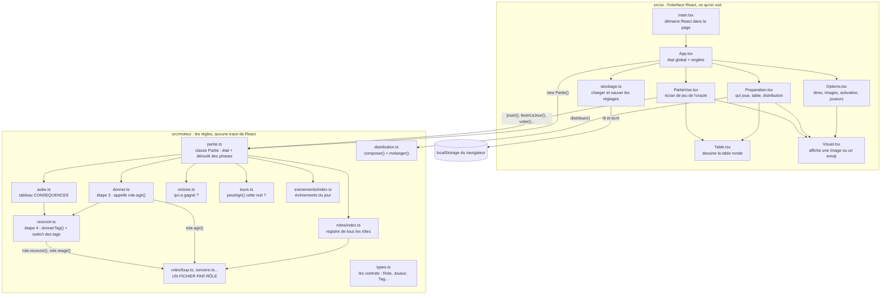
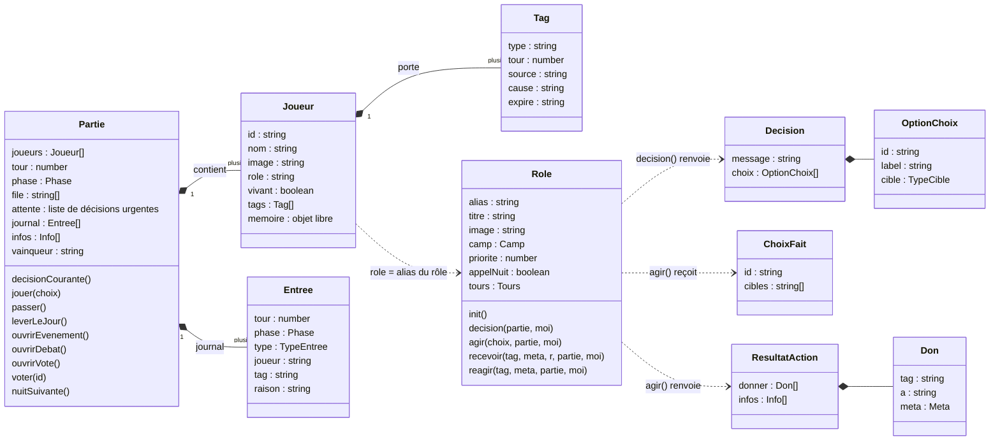
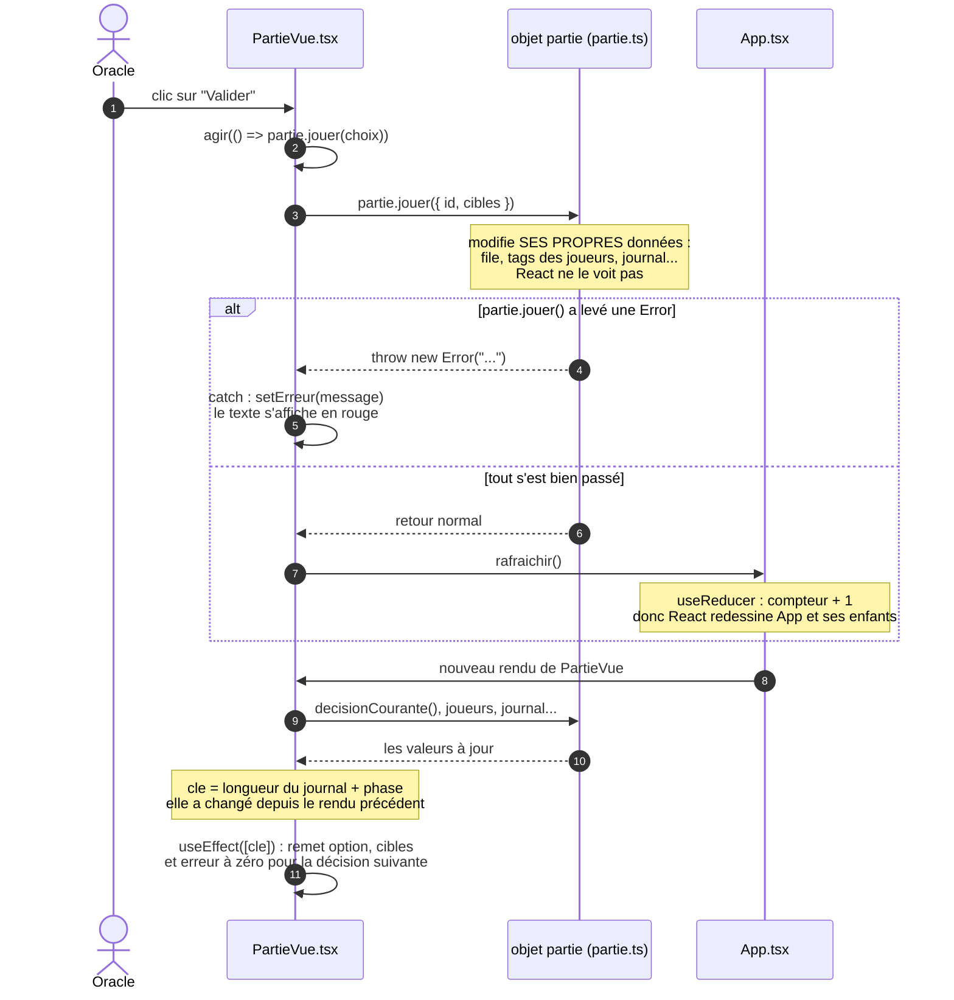
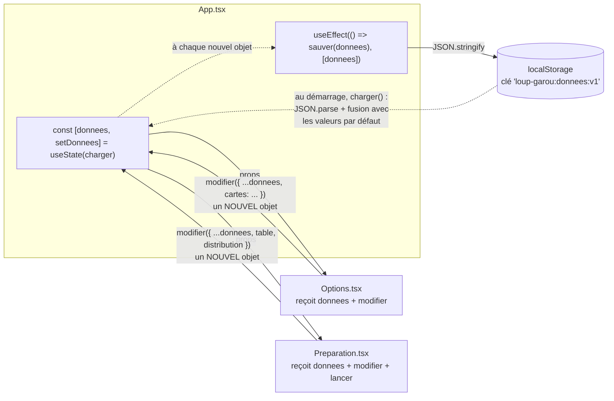
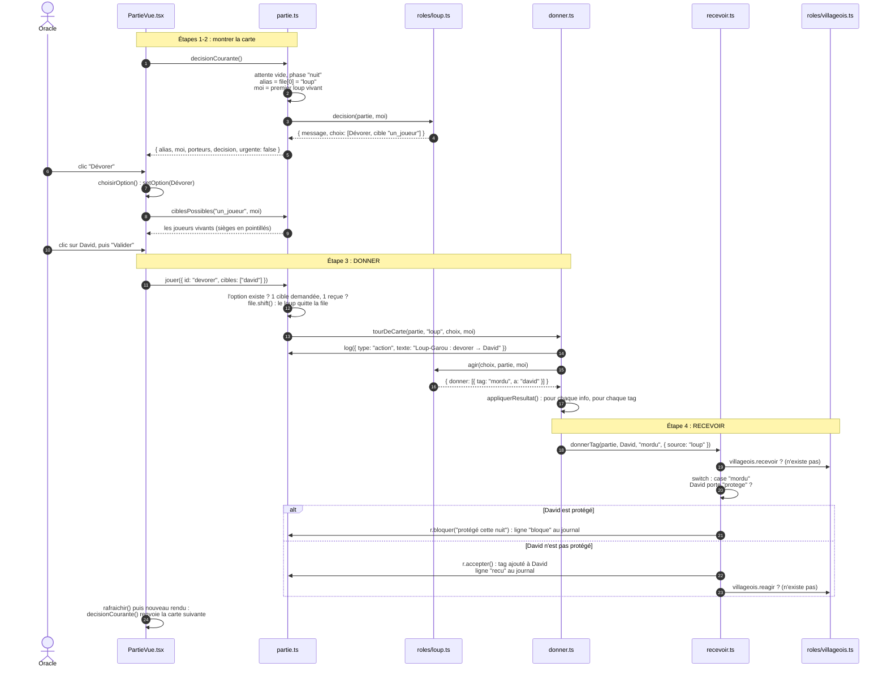
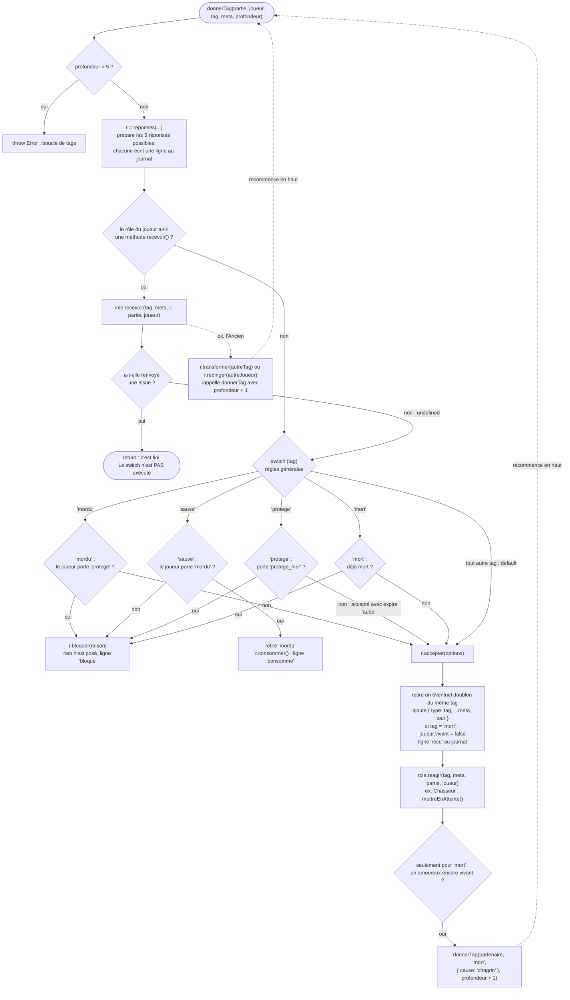
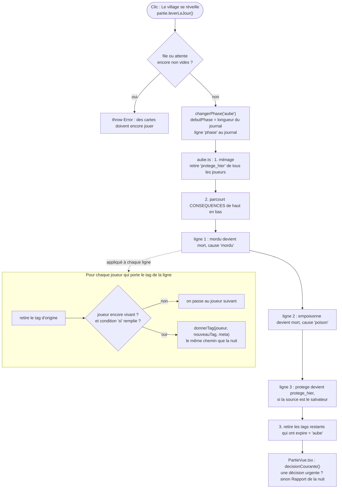
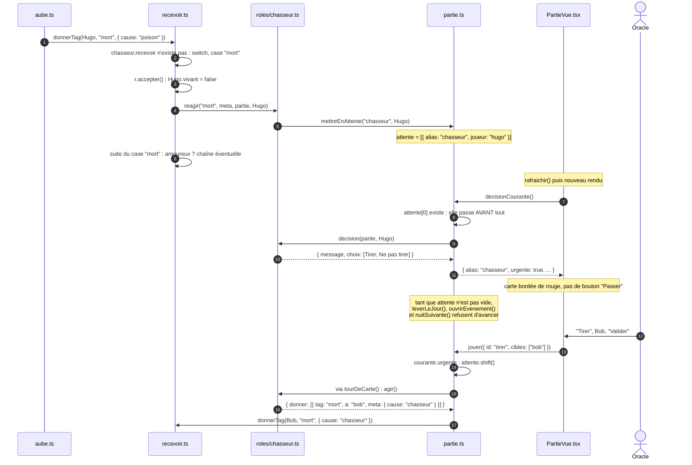
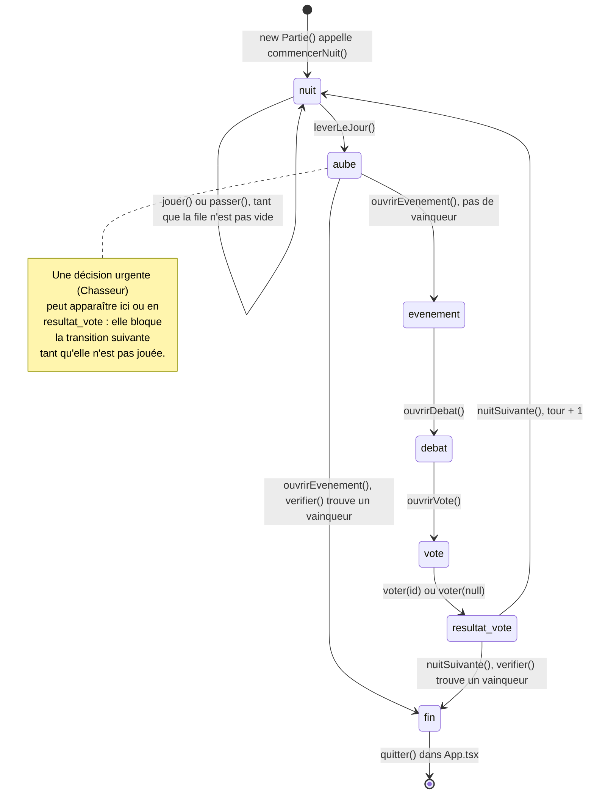

# Fonctionnement du code : une partie de bout en bout

Liens : [[design-patterns]] · [[donner-recevoir]] · [[cas-particulier]] · [[ajouter-corbeau]] · [[loup-garou-projet]]

> [!abstract] But de cette note
> Suivre **tout ce qui se passe dans le code** pendant une partie ordinaire, du chargement de la page jusqu'à l'écran de victoire, pour savoir **quel fichier ouvrir** quand on veut changer quelque chose.
>
> La note avance du général au détail :
> 1. la carte des fichiers ;
> 2. les objets que le code manipule ;
> 3. **le schéma complet d'une partie** (le schéma principal) ;
> 4. des zooms sur chaque mécanisme ;
> 5. un tableau « je veux changer X → j'ouvre Y ».

> [!info] Légende des couleurs (schémas 3 à 9)
> - 🟨 **Jaune** : un clic de l'oracle dans l'interface.
> - 🟩 **Vert** : du code React (dossier `src/ui/`).
> - 🟦 **Bleu** : du code du moteur de jeu (dossier `src/moteur/`).
> - ⬜ **Gris** : le stockage du navigateur.
> - Les **losanges** sont des questions que le code se pose (`if`).

---

## 1. La carte des fichiers

Le projet est coupé en **deux mondes** qui ne se mélangent pas :

- `src/ui/` : **l'interface**. Des composants React qui affichent des choses et réagissent aux clics. Ils ne contiennent **aucune règle du jeu**.
- `src/moteur/` : **les règles**. Du TypeScript pur, sans React. Ce dossier ne sait pas qu'une interface existe : on peut le faire tourner dans un test, sans navigateur (c'est ce que fait `npm test`).

Le seul pont entre les deux : l'interface crée un objet `Partie` (venu du moteur) et appelle ses méthodes (`jouer()`, `leverLeJour()`, `voter()`…).



`types.ts` n'a pas de flèche : **tous** les fichiers l'importent. Il ne contient aucun code exécuté, seulement la description de la forme des objets (voir partie 2).

### Rôle de chaque fichier, en une phrase

| Fichier | Ce qu'il fait | On l'ouvre pour… |
| --- | --- | --- |
| `ui/main.tsx` | Accroche React à la `<div id="root">` de `index.html`. | Presque jamais. |
| `ui/App.tsx` | Garde les réglages (`donnees`) et la partie en cours, affiche l'onglet choisi. | Ajouter une page, changer ce qui se passe au lancement. |
| `ui/Options.tsx` | Page Options : cartes et joueurs. | Changer l'affichage des cartes ou des joueurs. |
| `ui/Preparation.tsx` | Page Préparer : joueurs présents, places, distribution, lancement. | Changer la préparation d'une partie. |
| `ui/PartieVue.tsx` | Écran de jeu : table, décision en cours, étapes du jour, journal. | Changer ce que voit l'oracle pendant la partie. |
| `ui/Table.tsx` | Place des « sièges » en cercle. | Changer la forme de la table. |
| `ui/Visuel.tsx` | Affiche une image, un emoji, ou une initiale. | Changer l'affichage des images. |
| `ui/stockage.ts` | Lit et écrit les réglages dans le navigateur. | Brancher l'API Express + SQLite. |
| `moteur/partie.ts` | L'état d'une partie et le passage d'une phase à l'autre. | Changer le déroulé (ordre des phases, vote…). |
| `moteur/donner.ts` | Appelle `role.agir()` et distribue ce qu'il renvoie. | Rarement. |
| `moteur/recevoir.ts` | **Point d'entrée unique** de tout tag posé sur un joueur. | Ajouter une règle générale sur un tag. |
| `moteur/aube.ts` | Transforme les tags de la nuit en conséquences. | Ajouter une conséquence à l'aube, changer leur ordre. |
| `moteur/victoire.ts` | Décide si un camp a gagné. | Ajouter une condition de victoire. |
| `moteur/tours.ts` | Lit le champ `tours` d'un rôle. | Ajouter une nouvelle forme de `tours`. |
| `moteur/distribution.ts` | Compose et mélange le paquet de cartes. | Changer le nombre de loups, autoriser des doublons. |
| `moteur/roles/*.ts` | La logique de **chaque** rôle. | Créer ou modifier un rôle. |
| `moteur/roles/index.ts` | La liste des rôles existants. | Enregistrer un nouveau rôle. |
| `moteur/evenements/index.ts` | Les événements du jour. | Ajouter un événement. |
| `moteur/types.ts` | Les « contrats » : forme de chaque objet. | Ajouter un champ, un type de cible, un moment d'expiration. |

---

## 2. Les objets que le code manipule

Avant de suivre une partie, il faut connaître les objets qui circulent. Ce schéma montre leurs champs principaux et qui contient quoi.



> [!note] Ce qu'il faut retenir
> - **`Partie`** est le seul objet « vivant » : il change au fil de la partie. Tous les autres sont de simples objets de données.
> - **Un `Joueur` ne contient pas son rôle**, seulement son **alias** (`role: "sorciere"`). Pour obtenir l'objet rôle complet, on appelle `partie.roleDe(joueur)`, qui va le chercher dans le registre `ROLES`.
> - **Les objets `Role` sont partagés** : il n'existe qu'un seul objet `sorciere`, même s'il y avait deux sorcières. Tout ce qui doit être retenu *pour un joueur* (potions utilisées…) va donc dans **`joueur.memoire`**, jamais dans l'objet rôle.
> - **Un `Tag` est une étiquette avec des métadonnées** : `type` (son nom), `source` (qui l'a donné), `cause` (pourquoi, utile pour les morts), `expire` (quand il disparaît).
> - **`ChoixFait`** est ce que l'interface envoie au moteur quand l'oracle valide : l'`id` de l'option cliquée et les `id` des joueurs ciblés.
> - **`ResultatAction`** est ce qu'un rôle renvoie depuis `agir()` : il ne modifie rien lui-même, il **décrit** ce qu'il veut donner.

### Le champ `phase`

Une partie est toujours dans exactement une de ces phases :

| `phase` | Ce que montre l'écran | Méthode qui y fait entrer |
| --- | --- | --- |
| `"nuit"` | Les cartes une par une | `commencerNuit()` |
| `"aube"` | Le rapport de la nuit | `leverLeJour()` |
| `"evenement"` | L'événement du jour | `ouvrirEvenement()` |
| `"debat"` | Le minuteur | `ouvrirDebat()` |
| `"vote"` | La table cliquable | `ouvrirVote()` |
| `"resultat_vote"` | Le joueur éliminé | `voter()` |
| `"fin"` | Le vainqueur | `verifier()`, appelé par `ouvrirEvenement()` et `nuitSuivante()` |

---

## 3. Le schéma complet d'une partie

C'est le schéma principal. Il se lit de haut en bas, dans l'ordre où les choses arrivent. Chaque case indique **le fichier et la fonction** concernés. Les parties 4 à 10 zooment sur les cases les plus chargées.

```mermaid
flowchart TD
  classDef clic fill:#fff3c4,stroke:#c99a00,color:#222
  classDef react fill:#d9f2e3,stroke:#2e8b57,color:#222
  classDef moteur fill:#dde7ff,stroke:#3b5bdb,color:#222
  classDef stock fill:#eeeeee,stroke:#888888,color:#222

  subgraph S1["1 · Ouverture du site"]
    A1["main.tsx<br/>createRoot(...).render(App)"]:::react
    A2["App.tsx : useState(charger)<br/>charger() lit le localStorage,<br/>sinon crée 8 joueurs et active toutes les cartes"]:::react
    A3["App.tsx : page = 'preparation'<br/>affiche Preparation.tsx"]:::react
    A1 --> A2 --> A3
  end

  subgraph S2["2 · Préparation"]
    B1["Clic : cocher ou décocher un joueur"]:::clic
    B2["Preparation.tsx : basculer(id)<br/>calcule une NOUVELLE table<br/>et vide la distribution"]:::react
    B3["Clic : Distribuer / Redistribuer"]:::clic
    B4["distribution.ts : distribuer(table, actifs)<br/>composer() : 1 loup pour 4 joueurs,<br/>1 exemplaire de chaque rôle spécial activé,<br/>complété par des villageois<br/>melanger() : mélange de Fisher-Yates"]:::moteur
    B5["modifier(nouvellesDonnees)<br/>= setDonnees() de App"]:::react
    B6["App.tsx se redessine avec les nouvelles données<br/>useEffect([donnees]) : sauver()"]:::react
    B7[("localStorage")]:::stock
    B8["Clic : Lancer la partie<br/>(actif seulement si chaque joueur a une carte)"]:::clic
    B1 --> B2 --> B5
    B3 --> B4 --> B5
    B5 --> B6 --> B7
    B6 --> B8
  end

  subgraph S3["3 · Lancement"]
    C1["App.tsx : lancer()<br/>prépare 'apparence' (titres et images perso)<br/>et la liste des joueurs avec leur alias de rôle"]:::react
    C2["partie.ts : new Partie(joueurs, { apparence })"]:::moteur
    C3["constructor : chaque joueur reçoit<br/>vivant = true, tags = [], memoire = role.init()"]:::moteur
    C4["commencerNuit() : phase = 'nuit'<br/>file = rôles présents, appelNuit = true,<br/>peutAgir(role, tour) vrai,<br/>triés par priorité croissante"]:::moteur
    C5["App.tsx : setPartie(partie), setPage('partie')<br/>affiche PartieVue.tsx"]:::react
    C1 --> C2 --> C3 --> C4 --> C5
  end

  subgraph S4["4 · La nuit : une carte après l'autre"]
    D1["PartieVue.tsx, à chaque rendu :<br/>courante = partie.decisionCourante()"]:::react
    D2{"partie.attente<br/>contient une décision urgente ?"}
    D3{"phase = 'nuit' et<br/>partie.file pas vide ?"}
    D4["role.decision(partie, moi)<br/>renvoie un message + les choix"]:::moteur
    D5["Clic : une option<br/>Dévorer, Protéger, Potion de vie..."]:::clic
    D6["Clic : la ou les cibles, puis Valider"]:::clic
    D6b["Clic : Passer<br/>partie.passer()"]:::clic
    D7["partie.jouer(choix)<br/>vérifie l'option et le nombre de cibles,<br/>retire la carte de la file"]:::moteur
    D8["donner.ts : tourDeCarte()<br/>role.agir() renvoie { donner, infos }"]:::moteur
    D9["recevoir.ts : donnerTag() pour chaque tag donné<br/>le receveur accepte, bloque, transforme..."]:::moteur
    D10["rafraichir() : React redessine l'écran"]:::react
    D1 --> D2
    D2 -- oui --> D4
    D2 -- non --> D3
    D3 -- oui --> D4
    D4 --> D5 --> D6 --> D7 --> D8 --> D9 --> D10
    D4 --> D6b --> D10
    D10 --> D1
  end

  subgraph S5["5 · L'aube"]
    E0["Clic : Le village se réveille"]:::clic
    E1["partie.leverLeJour()<br/>refuse si des cartes doivent encore jouer<br/>phase = 'aube'"]:::moteur
    E2["aube.ts : aube(partie)<br/>mordu devient mort, empoisonne devient mort,<br/>protege devient protege_hier<br/>chaque conséquence repasse par donnerTag()"]:::moteur
    E3["PartieVue.tsx : Rapport de la nuit<br/>partie.morts() relit le journal"]:::react
    E0 --> E1 --> E2 --> E3
  end

  subgraph S6["6 · Le jour"]
    F1["Clic : Événement du jour"]:::clic
    F2{"partie.ouvrirEvenement()<br/>verifier() : un camp a gagné ?"}
    F3["événement tiré au hasard<br/>evenement.appliquer() renvoie { donner, infos }<br/>appliquerResultat() : même chemin que les rôles"]:::moteur
    F4["Clic : Ouvrir le débat<br/>partie.ouvrirDebat()"]:::clic
    F5["Minuteur dans PartieVue.tsx<br/>useEffect + setInterval : -1 seconde par seconde"]:::react
    F6["Clic : Passer au vote<br/>partie.ouvrirVote()"]:::clic
    F7["Clic : un siège de la table<br/>ou Personne n'est éliminé"]:::clic
    F8["partie.voter(id)<br/>phase = 'resultat_vote'<br/>donne le tag 'mort' (cause 'vote') via donnerTag()"]:::moteur
    F9["Clic : La nuit tombe"]:::clic
    F10{"partie.nuitSuivante()<br/>verifier() : un camp a gagné ?"}
    F11["tour = tour + 1<br/>commencerNuit() reconstruit la file"]:::moteur
    F1 --> F2
    F2 -- non --> F3 --> F4 --> F5 --> F6 --> F7 --> F8 --> F9 --> F10
    F10 -- non --> F11
  end

  subgraph S7["7 · Fin de partie"]
    G1["phase = 'fin'<br/>PartieVue.tsx affiche le vainqueur"]:::moteur
    G2["Clic : Nouvelle partie<br/>App.tsx : quitter()<br/>setPartie(null), retour à la préparation"]:::clic
    G1 --> G2
  end

  A3 --> B1
  A3 --> B3
  B8 --> C1
  C5 --> D1
  D3 -- "non : toutes les cartes ont joué" --> E0
  E3 -. "si un chasseur vient de mourir :<br/>décision urgente d'abord" .-> D1
  E3 --> F1
  F8 -. "si le joueur éliminé est chasseur<br/>ou amoureux : réactions en chaîne" .-> D1
  F11 --> D1
  F2 -- oui --> G1
  F10 -- oui --> G1
  G2 --> B1
```



### Les points clés de ce schéma

1. **La boucle de la nuit (bloc 4) est une boucle de rendus React**, pas une boucle `for`. Il n'y a nulle part de code « pour chaque carte, faire… » qui attendrait les clics. À chaque rendu, `PartieVue` **demande** au moteur « qui joue maintenant ? » (`decisionCourante()`). Après un clic, le moteur retire la carte de la file, React redessine, et la question est reposée. Quand la file est vide, la réponse est « personne », et l'écran affiche le bouton « Le village se réveille ».
2. **Une décision urgente passe avant tout** (losange D2). C'est ce qui permet au Chasseur de tirer pendant l'aube ou après un vote, alors que ce n'est pas la nuit.
3. **La victoire n'est vérifiée qu'à deux endroits** : en cliquant « Événement du jour » et en cliquant « La nuit tombe ». L'oracle voit donc toujours le rapport des morts avant l'écran de victoire.
4. **Le vote, l'aube, les événements et les rôles utilisent tous `donnerTag()`**. Une mort par vote déclenche donc le Chasseur et les amoureux exactement comme une mort de nuit, sans code dédié.

---

## 4. Zoom : comment React et le moteur se parlent

C'est le point le plus délicat à comprendre côté React.

### Deux sortes d'état dans `App.tsx`

```ts
const [donnees, setDonnees] = useState<Donnees>(charger);   // les réglages
const [partie, setPartie] = useState<Partie | null>(null);   // la partie en cours
const [, rafraichir] = useReducer((x: number) => x + 1, 0);  // un simple compteur
```

- **`donnees`** (joueurs, cartes, table, distribution) est géré « à la manière React » : on ne le modifie jamais, on en crée une **copie modifiée** (`{ ...donnees, table: nouvelleTable }`) et on la passe à `setDonnees`. React voit un nouvel objet, donc il redessine.
- **`partie`** est géré autrement : c'est un objet de classe qui **se modifie lui-même** (`this.file.shift()`, `joueur.tags.push(...)`…). Pour React, c'est toujours **le même objet** : il ne peut pas deviner qu'il a changé à l'intérieur.

C'est le rôle de **`rafraichir`**. `useReducer` est utilisé ici comme un compteur : chaque appel à `rafraichir()` fait `x + 1`, ce qui change l'état de `App`, donc React redessine `App` **et tous ses enfants**, dont `PartieVue`, qui relit alors le contenu à jour de `partie`.

> [!warning] La règle à respecter
> Après **chaque** appel à une méthode de `partie` qui change quelque chose, il faut appeler `rafraichir()`. Sinon, le moteur a bien changé mais l'écran reste figé. Dans `PartieVue.tsx`, la petite fonction `agir(fn)` s'en charge : on écrit toujours `agir(() => partie.uneMethode())`.

> [!note] Deux fonctions qui s'appellent `agir`
> - `role.agir()` dans les fichiers de rôles : l'étape 3, ce que le rôle donne.
> - `agir(fn)` dans `PartieVue.tsx` : une fonction d'interface qui exécute `fn`, attrape les erreurs, puis appelle `rafraichir()`.
>
> Elles n'ont rien à voir l'une avec l'autre.

### Le cycle d'un clic



### Le `useEffect` qui réinitialise la sélection

```ts
const cle = `${partie.journal.length}-${partie.phase}`;
useEffect(() => {
  setOption(null);
  setCibles([]);
  setErreur(null);
}, [cle]);
```

`option` et `cibles` sont l'état local de l'écran : « quelle option l'oracle a cliquée » et « quels joueurs il a sélectionnés ». Quand une carte a fini de jouer, cette sélection ne doit pas déborder sur la carte suivante. La « clé » est construite à partir de deux valeurs qui changent forcément dès que le moteur avance : la longueur du journal (chaque action ajoute au moins une ligne) et la phase. Dès qu'elle change, l'effet vide la sélection.

### Le `useEffect` du minuteur

```ts
useEffect(() => {
  if (!actif || reste <= 0) return;                            // en pause ou fini : pas d'intervalle
  const t = setInterval(() => setReste(r => Math.max(0, r - 1)), 1000);
  return () => clearInterval(t);                               // nettoyage
}, [actif, reste <= 0]);
```

- L'intervalle retire une seconde toutes les secondes.
- La fonction renvoyée (`return () => clearInterval(t)`) est le **nettoyage** : React l'appelle quand le composant disparaît (on passe au vote) ou avant de relancer l'effet. Sans elle, l'intervalle continuerait à tourner dans le vide.
- Les dépendances sont `actif` et `reste <= 0`, **pas** `reste` : on ne veut pas recréer l'intervalle à chaque seconde, seulement quand on met en pause ou quand on atteint zéro.
- `setReste(r => ...)` utilise la forme « fonction » de `setState` : elle reçoit la valeur la plus récente, ce qui évite de lire une valeur périmée de `reste` dans l'intervalle.

---

## 5. Zoom : préparation et sauvegarde des réglages



- **Les pages ne stockent pas les réglages elles-mêmes.** Elles reçoivent `donnees` (pour afficher) et `modifier` (pour changer). `modifier` n'est autre que `setDonnees` de `App`. Ce principe s'appelle « faire remonter l'état » (voir [[design-patterns]]).
- **`useState(charger)`** : on passe la *fonction* `charger`, sans parenthèses. React ne l'appelle qu'au tout premier rendu. Avec `useState(charger())`, la lecture du localStorage se ferait à chaque rendu, pour rien.
- **La fusion avec les valeurs par défaut** dans `charger()` :
  ```ts
  cartes: { ...defaut.cartes, ...lu.cartes }
  ```
  Les rôles du code d'abord, puis les réglages enregistrés par-dessus. Un rôle ajouté dans le code après coup n'existe pas dans les réglages enregistrés : il garde donc sa valeur par défaut (activé). C'est pour ça qu'un nouveau rôle apparaît tout seul dans Options.
- **Les valeurs calculées ne sont pas stockées.** Dans `Preparation.tsx`, `table`, `actifs`, `distributionValide` et `composition` sont recalculés à chaque rendu à partir de `donnees`. Il n'y a donc aucun risque qu'ils soient désynchronisés.

### Les places autour de la table

`Preparation.tsx` garde un état local `selection` : l'id du premier siège cliqué. Au second clic, `cliquerSiege()` échange les deux joueurs dans `donnees.table` (un tableau d'ids, dans l'ordre de la table). La distribution n'est pas touchée : chaque joueur garde sa carte en changeant de place.

`Table.tsx` place le siège numéro `i` sur un cercle :

```ts
const angle = (i / n) * 2 * Math.PI - Math.PI / 2;   // - PI/2 : le premier siège est en haut
left: `${50 + 41 * Math.cos(angle)}%`
top:  `${50 + 41 * Math.sin(angle)}%`
```

---

## 6. Zoom : un tour de carte pendant la nuit

Exemple : c'est au tour des loups, qui attaquent David (Villageois).



> [!note] Les loups jouent « ensemble »
> `decisionCourante()` renvoie `porteurs` (tous les loups vivants, affichés en surbrillance) mais `moi` est seulement **le premier** d'entre eux. Pour le loup, ça ne change rien car `agir()` ne lit pas `moi`. Un futur rôle en plusieurs exemplaires qui a besoin de `moi.memoire` devra en tenir compte.

> [!note] Le moteur ne vérifie que le **nombre** de cibles
> `jouer()` contrôle que l'option existe et que le nombre de cibles est bon. Il ne contrôle pas que la cible fait partie de `ciblesPossibles()` : c'est l'interface qui ne propose que les bonnes cibles. Les vraies interdictions de jeu (« pas deux protections de suite ») sont des règles du **receveur**, dans `recevoir.ts`.

---

## 7. Zoom : `donnerTag()`, le cœur du moteur

**Tout** tag posé sur un joueur passe par cette fonction de `recevoir.ts`, qu'il vienne d'un rôle, de l'aube, d'un vote ou d'un événement.



### Les cinq réponses d'un receveur

| Réponse | Ce qu'elle fait | Ligne au journal | Exemple |
| --- | --- | --- | --- |
| `r.accepter(opts)` | Pose le tag, puis appelle `reagir()` | `recu` | Le cas normal |
| `r.bloquer(raison)` | Ne pose rien | `bloque` | Morsure sur un joueur protégé |
| `r.consommer(raison)` | Ne pose rien, mais le tag « a servi » | `consomme` | La potion de vie qui annule une morsure |
| `r.transformer(autre)` | Pose un **autre** tag à la place, via `donnerTag` | `transforme` | L'Ancien : `mort` devient `vie_perdue` |
| `r.rediriger(joueur)` | Envoie le **même** tag à un autre joueur, via `donnerTag` | `redirige` | Aucun rôle pour l'instant |

### `recevoir()` ou `reagir()` ?

- **`recevoir()`** est appelé **avant** : il peut empêcher ou modifier le tag. S'il renvoie une réponse, les règles générales **ne s'exécutent pas**, y compris la chaîne des amoureux.
- **`reagir()`** est appelé **après**, une fois le tag posé : il ne peut plus l'empêcher, il déclenche une suite.

Pour « faire quelque chose quand je meurs », c'est `reagir()`. Pour « ne pas mourir dans tel cas », c'est `recevoir()`. Le détail est dans [[cas-particulier]].

### La profondeur

`profondeur` compte combien de `donnerTag` sont imbriqués les uns dans les autres. Le loup qui mord : profondeur 0. L'Ancien qui transforme sa mort : `vie_perdue` arrive en profondeur 1. Un amoureux qui meurt de chagrin : profondeur 1. Au-delà de 5, le moteur s'arrête avec une erreur plutôt que de tourner en boucle à l'infini (deux rôles qui se redirigeraient un tag l'un à l'autre, par exemple). Dans le journal de l'oracle, cette profondeur se voit sous forme d'indentation.

---

## 8. Zoom : l'aube



- **L'ordre des lignes de `CONSEQUENCES` est une règle du jeu.** Les morsures sont traitées avant les poisons. La note [[cas-particulier]] montre un exemple où inverser l'ordre change le journal.
- **Le test « encore vivant ? »** évite de tuer deux fois un joueur qui était à la fois mordu et empoisonné.
- **Le rapport** (`partie.morts()`) relit le journal depuis `debutPhase` et garde les lignes « `recu` `mort` ». Il n'y a pas de variable « morts de la nuit » à tenir à jour : le journal suffit.

---

## 9. Zoom : une décision urgente (le Chasseur)



Ce mécanisme fonctionne dans **n'importe quelle phase** : nuit, aube ou résultat du vote. C'est l'outil à utiliser pour tout rôle qui doit **agir en réaction**, en dehors de son tour normal.

---

## 10. Les phases et leurs transitions



Chaque transition est **une méthode de `Partie`**. Chaque méthode commence par vérifier qu'elle a le droit d'avancer (file vide, pas de décision en attente…) et lève une `Error` sinon. L'interface ne fait qu'appeler ces méthodes et afficher l'écran qui correspond à `partie.phase` (le `switch` du composant `EtapeDeJour` dans `PartieVue.tsx`).

### Les conditions de victoire (`victoire.ts`)

Testées dans cet ordre, la première vraie l'emporte :

1. Plus aucun vivant : « Personne : le village est désert. »
2. Exactement deux vivants, tous deux `amoureux` : « Les amoureux ».
3. Plus aucun loup vivant : « Le village ».
4. Au moins autant de loups que de non-loups : « Les loups-garous ».

---

## 11. Je veux changer X : quel fichier ouvrir ?

| Je veux… | Fichier(s) | Où exactement |
| --- | --- | --- |
| Ajouter un rôle | `roles/<alias>.ts` + `roles/index.ts` | Copier `_template.ts`, voir [[ajouter-corbeau]] |
| Changer ce qu'un rôle propose à l'oracle | `roles/<alias>.ts` | `decision()` |
| Changer ce qu'un rôle fait | `roles/<alias>.ts` | `agir()` |
| Qu'un rôle réagisse différemment à un tag qu'il reçoit | `roles/<alias>.ts` | `recevoir()` (avant) ou `reagir()` (après) |
| Changer l'ordre d'appel la nuit | `roles/<alias>.ts` | `priorite` |
| Limiter un rôle à certaines nuits | `roles/<alias>.ts` | `tours` (et `tours.ts` pour une nouvelle forme) |
| Ajouter une règle générale sur un tag | `recevoir.ts` | un `case` dans le `switch` de `donnerTag()` |
| Qu'un tag produise un effet à l'aube | `aube.ts` | une ligne dans `CONSEQUENCES` |
| Qu'un tag dure plus longtemps | `types.ts` + `partie.ts` | `Meta.expire` + le retrait au bon moment |
| Un nouveau type de cible | `types.ts` + `partie.ts` | `TypeCible`, `ciblesPossibles()`, `nbCibles()` |
| Une nouvelle condition de victoire | `victoire.ts` | `verifierVictoire()` |
| Changer le nombre de loups ou autoriser des doublons | `distribution.ts` | `composer()` |
| Ajouter un événement | `evenements/index.ts` | un objet + l'ajouter dans `LISTE_EVENEMENTS` |
| Changer l'ordre des phases du jour | `partie.ts` + `PartieVue.tsx` | les méthodes de phase + `EtapeDeJour` |
| Compter les voix au lieu de cliquer l'éliminé | `partie.ts` + `PartieVue.tsx` | `voter()` + `case "vote"` de `EtapeDeJour` |
| Changer le libellé d'un tag sur la table | `PartieVue.tsx` | dictionnaire `TAGS` |
| Changer le texte d'une cause de mort dans le rapport | `PartieVue.tsx` | dictionnaire `CAUSES` |
| Changer une couleur ou une taille | `styles.css` | les variables `--…` en haut du fichier |
| Changer la durée par défaut du débat | `stockage.ts` | `dureeDebat` dans `parDefaut()` |
| Remplacer le localStorage par l'API + SQLite | `stockage.ts` | `charger()` et `sauver()` uniquement |
| Ajouter une page | `App.tsx` | le type `Page`, un onglet, un rendu conditionnel |

---

## 12. Points d'attention dans le code actuel

Ce sont des choix simplificateurs du prototype. Ils fonctionnent, mais il vaut mieux les connaître avant de modifier le code.

- **`decisionCourante()` peut modifier la file.** Si une carte de la file n'a plus de porteur vivant, la méthode la retire et passe à la suivante. Avec les rôles actuels, ça n'arrive pas (personne ne meurt avant l'aube), mais un futur rôle qui tue immédiatement pendant la nuit le déclencherait. Une fonction qui « lit » et qui modifie en même temps est une source de surprises : si un jour elle doit être appelée ailleurs, garder ce comportement en tête.
- **`joueur.memoire` n'est pas typé** (`Record<string, any>`). TypeScript ne signalera pas une faute de frappe comme `moi.memoire.potionVi`.
- **Le vote ne compte pas les voix** : l'oracle clique directement sur l'éliminé.
- **Pour un rôle en plusieurs exemplaires, `moi` est le premier porteur vivant** (voir partie 6).
- **Le journal n'est jamais vidé.** Le composant `Journal` n'affiche que le tour en cours, mais tout reste en mémoire. Sur une très longue partie, ce n'est pas un problème en pratique.
- **Rien n'est sauvegardé pendant une partie** : recharger la page en cours de partie la perd (les réglages, eux, sont conservés).
- **`main.tsx` utilise `<StrictMode>`.** En mode développement, React exécute certains rendus et effets **deux fois** pour détecter les erreurs. Si un `console.log` apparaît en double pendant `npm run dev`, c'est normal ; ça n'arrive pas après `npm run build`.
